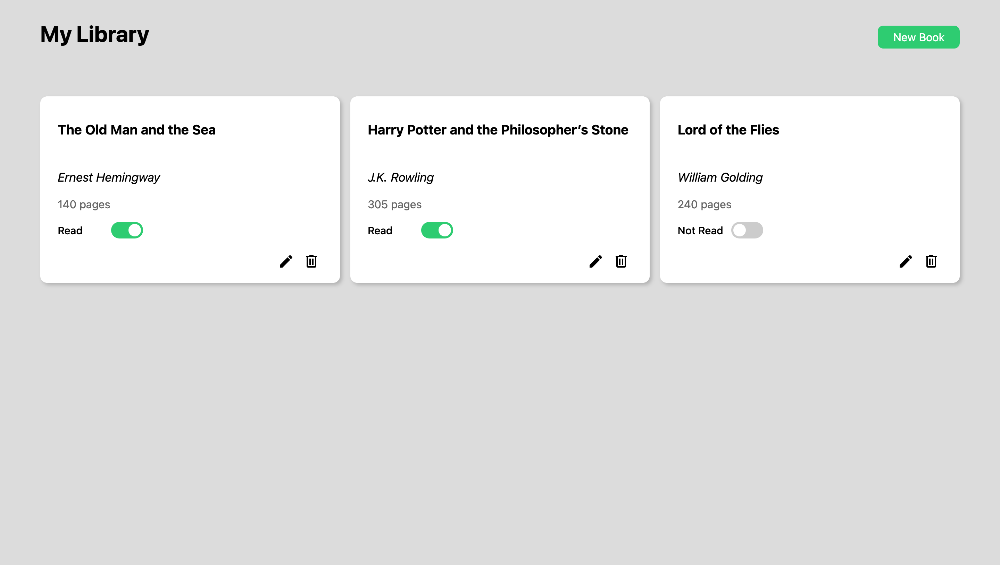

# Library

A small dynamic web application that allows users to keep track of their book collection.

🔗 **[Online demo](https://ikab08.github.io/library/)**

## Features

- Add New Books
- Toggle Reading Status
- Edit Books
- Delete Books
- Pre-populated Data

## Technologies
HTML, CSS, JavaScript

## Run locally
Clone the repository, then open `index.html` in your browser.